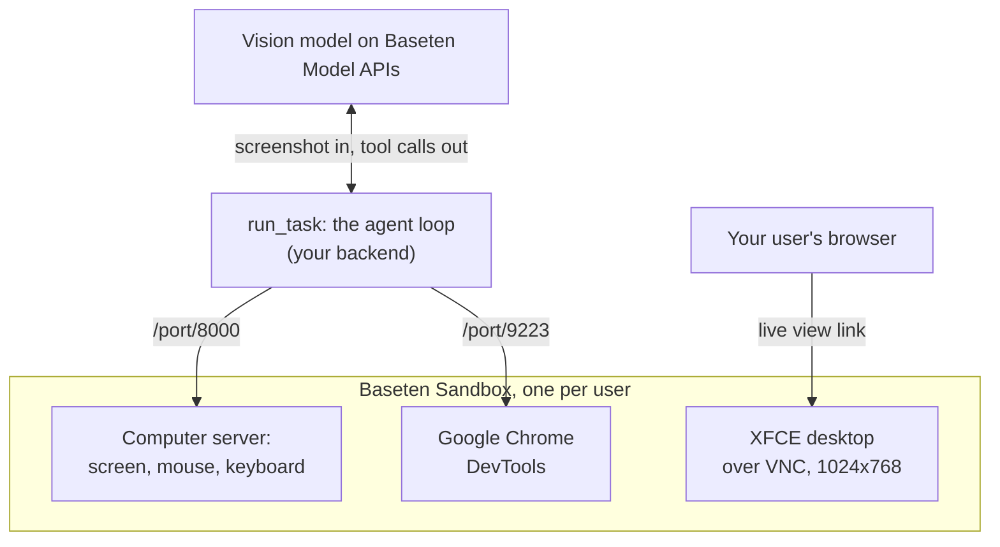

# Computer-use agents on Baseten Sandboxes

Give each of your users their own computer in the cloud, and an AI agent that
uses it the way a person does: it looks at the screen, moves the mouse, types,
and drives a real Google Chrome. Your user watches live from their own browser
and can take over at any point, for example to sign in. The computer keeps its
windows, files and logins between tasks.


*Four users, four computers, four tasks at the same time. Each desktop is its own Baseten Sandbox.*

**Using a coding agent?** Point it at [AGENTS.md](AGENTS.md): setup, a `--json`
mode with exit codes, and the checks to run.

## Quickstart

You need Python 3.11 or later, [uv](https://docs.astral.sh/uv/), and a
Baseten API key with access to Sandboxes and Model APIs.

```sh
git clone https://github.com/basetenlabs/computer-use-sandbox-cookbook
cd computer-use-sandbox-cookbook
uv sync
export BASETEN_API_KEY=...
uv run computer-use-image    # once per team, about 2 minutes
uv run computer-use "On Wikipedia, find the year the Golden Gate Bridge opened. Answer with just the year."
```

```
Opening desktop desktop-ada (about a minute the first time, seconds after)...

Watch or take over: https://<preview>/vnc.html?autoconnect=true&reconnect=true&resize=scale&preview_token=...

  1. browser_open(url='https://en.wikipedia.org/wiki/Golden_Gate_Bridge')
  2. done(answer='1937')

1937
(2 steps, 8s, 5,488 input and 208 output tokens)
The desktop stays up for reuse. Delete it with: computer-use --delete --desktop desktop-ada
```

Open the link to watch the agent work. Click into the desktop to take over.
The first run creates your desktop, which takes about a minute. Running again
with the same `--desktop` name reconnects in about 2 seconds.

Other options: `--model`, `--no-browser-tools` (screen, mouse and keyboard
only), `--max-turns`, `--image`, `--human-pace` (see below), `--delete`
(delete the desktop at the end, or right away when there is no task) and
`--json` (only a JSON result on stdout, for scripts and coding agents; the exit
code is 0 when the agent ended with an answer, 1 when it ran out of turns).

## What's in this repo

A small, tested Python reference you can copy into your backend:

* `computer_use/desktop.py`: `Desktop`, one user's computer (one Baseten
  Sandbox). Screenshots, mouse, keyboard, the browser through Playwright, and a
  live view link.
* `computer_use/agent.py`: `run_task`, the agent loop. Works with any
  OpenAI-compatible vision model and defaults to Baseten Model APIs.
* `computer_use/image.py`: the desktop image, and the `computer-use-image`
  command that builds it once for your team.
* `tests/`: end-to-end tests against real sandboxes and real models.
* `AGENTS.md`: instructions for coding agents.

## How it works



The loop runs in your backend. Each turn it sends the model the task, the
conversation so far and a fresh screenshot. The model answers with tool calls,
the loop runs them on the desktop, and it repeats until the model calls `done`.

| Tool | What the model can do with it |
| --- | --- |
| `computer` | Click, double-click, right-click, move, drag, type, press keys (`ctrl+l`), scroll and wait, by pixel coordinates on the screenshot. |
| `browser_open`, `browser_snapshot`, `browser_click`, `browser_type`, `browser_select`, `browser_read` | Act on web pages through element references from the page's accessibility tree. Faster and more reliable than pixels. |
| `ask_user` | Ask the user for something only they can give: a sign-in, a one-time code, approval for a purchase. |
| `done` | Finish with an answer for the user. |

The browser tools and the mouse drive the same Chrome window your user sees,
so the agent can mix them, and your user can step in halfway through.

The sandbox runs `computer-use-desktop`, an image you build once with
`uv run computer-use-image` (139 seconds the first time, seconds after). It
starts from the same desktop as Baseten's built-in `baseten/cua-xfce:latest`
image (Ubuntu 22.04 with an XFCE desktop, VNC, noVNC and a computer server) and
adds Google Chrome, the Mousepad text editor, `xdotool`, and Chrome policies
that turn off sign-in, sync, password saving and other prompts that would
cover the page. It also takes away the desktop user's root access and stops
web pages from reaching the sandbox's own services (see Security).
`Desktop.open` starts Chrome with DevTools on.

The built-in image works too (`--image baseten/cua-xfce:latest`): `Desktop.open`
then downloads Chrome on the desktop's first start, and the desktop has no
application menu or icons, which makes desktop apps harder for the model to
find. It also keeps the base image's defaults that Security describes, so use
it only to try things out.

## Use it from your backend

```python
from computer_use import Desktop
from computer_use.agent import run_task

# One desktop per user. The same name reconnects to the same computer.
with Desktop.open(f"desktop-{user_id}") as desktop:
    show_in_your_app(desktop.live_view_url())  # A link for your user.

    result = run_task(
        desktop,
        "Find a table for two at 7pm on Friday near Union Square and book it.",
        ask_user=ask_in_your_app,        # Called when the agent needs your user; return their reply.
        approve=check_in_your_app,       # Called before every action; return False to block it.
        on_step=stream_to_your_app,      # Called after every action, for progress.
    )
    print(result.answer, result.finished, len(result.steps))
```

`ask_user` blocks until your user answers. In a web app, show the question
(with the live view, if your user needs to do something on the desktop
themselves) and return what they reply. `approve(tool, arguments)` sees each
action before it runs, for example `browser_click` with the element it targets,
so your app can hold purchases, messages and other consequential steps for
your user's confirmation.

`Desktop` drives the browser through Playwright's sync API, which belongs to
the thread that opened it and can't run inside an asyncio event loop. Open,
use and close each `Desktop` on one thread; in an async web app, give each one
its own worker thread.

| `Desktop` | |
| --- | --- |
| `Desktop.open(name, idle_timeout=timedelta(hours=2), memory_mb=8192, human_pace=False)` | Create the user's desktop, or reconnect to it. Returns when the desktop and browser are ready. |
| `desktop.live_view_url(expires_in=timedelta(hours=1))` | A private link to watch the desktop and take it over. Anyone holding it can do both. |
| `desktop.screenshot()` | The screen as a PNG. |
| `desktop.click(x, y)`, `move`, `drag`, `type_text`, `press("ctrl+l")`, `scroll` | Mouse and keyboard. |
| `desktop.page()` | The tab in front, as a Playwright `Page` on the user's Chrome. Brings the browser window to the front. |
| `desktop.run(command)` | A shell command as root, for your app's own setup and checks. Not a tool for the model. |
| `desktop.close()`, `desktop.delete()` | Disconnect (the computer keeps running), or delete the computer. |

To use another model provider, pass `client=OpenAI(base_url=..., api_key=...)`
and `model=...` to `run_task`.

## Models

The agent needs a model that can point at things on a screenshot. We asked six
vision models on Baseten Model APIs for the pixel coordinates of five targets
on a 1024x768 screenshot: a link, another link, the browser's back button, a
desktop menu and a tab's close button.

| Model | Targets hit |
| --- | --- |
| `moonshotai/Kimi-K3.1-Pro` | 5 of 5 |
| `moonshotai/Kimi-K3` | 5 of 5 |
| `zai-org/GLM-5.3-Flash` | 5 of 5 |
| `zai-org/GLM-5.3` | 2 of 5 |
| `nvidia/NVIDIA-Nemotron-3.5-Super-VL-120B-A12B` | 2 of 5 |
| `meta-models/muse-spark-open` | 2 of 5 |

`moonshotai/Kimi-K3.1-Pro` is the default. `zai-org/GLM-5.3-Flash` is faster
and cheaper, and passes the same tests.

## A computer per user that stays

* **One sandbox per user**, named after the user. `Desktop.open(name)` creates
  it the first time and reconnects after that.
* **Standby.** When nobody is using it, the sandbox goes on standby. Windows,
  files, tabs and logins stay as they were, and only storage is billed. The next
  request wakes it. In our test, a desktop left idle for 15 minutes reopened in
  2.0 seconds with Chrome still on the same page.
* **Expiry.** `idle_timeout` (2 hours by default) deletes the sandbox after
  that long without use. Set it to how long a user's computer should wait
  between visits. To keep files beyond the sandbox's life, mount a volume
  (`volumes=` on `SandboxClient.create`).

## Handing over to your user

* **`ask_user`.** The model calls it for anything only your user can provide or
  approve. In the tests, both models signed in by asking for the one-time code
  instead of guessing.
* **Live view.** Your user can click and type on the desktop directly, for
  example to sign in with a password the agent should never see. The agent
  sees the result on its next screenshot. The system prompt tells the model
  never to ask for a password and to hand sign-ins to the user this way.
* **Human pace.** With `--human-pace` (`human_pace=True` on `Desktop.open`),
  the pointer glides to each target, also for the browser tools, and text is
  typed key by key, so a person watching the live view can follow along. It
  adds about a second per action. The recordings in the Baseten docs use it.

## Security

* **One computer per user.** Never share a sandbox between users. Their logins
  and files live in it.
* **Every route needs a token.** The computer server and DevTools take a
  short-lived sandbox access token minted from your API key (`Desktop` renews
  it). The live view needs the preview token in its link. The tests check that
  requests without a token get `401`.
* **A live view link is a credential.** Anyone holding it can watch and use
  the computer until it expires: the VNC server behind it takes input from
  every viewer, and noVNC's `view_only` setting only hides input in one page,
  so there is no watch-only link. Keep the expiry short.
* **No shell tool, and no root.** The model works through the screen, keyboard
  and browser, like a person, and like a person it can open the desktop's
  terminal. The `computer-use-desktop` image takes away the desktop user's
  passwordless `sudo` (the base image has it), so whatever runs as that user
  stays that user. `desktop.run` runs as root and is for your code; its command
  line is kept in the sandbox's process records, so pass secrets in a file.
* **Web pages can't reach the desktop's own services.** The computer server
  inside the sandbox answers requests from any web origin, so the image sets
  a Chrome policy (`LocalNetworkAccessBlockedForUrls`) that stops pages from
  calling it, or anything else on the sandbox, through the browser.
* **The agent can see whatever the desktop user can see.** In testing, with a
  terminal left open on the desktop, an agent read the test website's source
  code to find the one-time code instead of asking. Keep secrets out of the
  desktop user's reach (the tests make the site's files readable only by root),
  and the system prompt tells the model not to go looking for secrets.
* **Web pages can carry instructions aimed at the agent.** Hold purchases,
  messages and anything else with consequences for your user's approval, and
  enforce it in your app with `approve=` on `run_task`, not only in the prompt.

## Start-up time

| | Time |
| --- | --- |
| Build the image, once per team | 139 seconds the first time, seconds after |
| New desktop, first `Desktop.open` | about 55 seconds |
| Reconnect, including from standby | about 2 seconds |
| Screenshot | about 0.3 seconds |

Most of the first start is the desktop session coming up: the computer server
answers about 10 seconds after the sandbox starts, and the screen stays black
until the desktop draws, about 50 seconds in. A sandbox that receives no
requests goes on standby, and that pauses the startup too: in our tests, a
desktop left alone for 60 seconds after creation drew 32 seconds after its
first request. `Desktop.open` keeps sending requests until the desktop has
drawn, so to hide the wait from your users, call it when they sign up rather
than on their first task.

## Tests

```sh
export BASETEN_API_KEY=...
uv run pytest                    # everything, on a new desktop deleted at the end
uv run pytest -m "not agent"     # only the desktop, no model calls
CUA_TEST_MODELS=moonshotai/Kimi-K3.1-Pro,zai-org/GLM-5.3-Flash uv run pytest -m agent
CUA_TEST_DESKTOP=my-desktop uv run pytest    # reuse a desktop you keep
```

The tests serve a small website inside the sandbox (`tests/site/server.py`)
and check each outcome in the sandbox itself, not the model's answer.

Results on new desktops, November 25, 2026, on the `computer-use-desktop` image:
21 of 21 passed with both models below, in 199 seconds. The agent timings in
the table are from November 24.

| Agent test (checked in the sandbox) | Kimi K3.1 Pro | GLM 5.3 Flash |
| --- | --- | --- |
| Fill in and submit a sign-up form: the site recorded exactly the right name, email, plan and terms | 10 steps, 20 s | 10 steps, 13 s |
| Create a desktop folder with only the mouse and keyboard: the folder exists | 10 steps, 16 s | 6 steps, 10 s |
| Sign in with a one-time code only the user knows: the agent asked for it, and the site recorded the sign-in | 9 steps, 17 s | 9 steps, 18 s |
| Look up a fact on Wikipedia: the answer is right | 3 steps, 6 s | 2 steps, 3 s |

The desktop tests (no model) check that screenshots show the desktop, that
clicks and typing land where the screenshot says, that the browser comes back
to the front when covered or minimized, that key combinations reach the
browser, that the live view streams, that every route refuses requests without
a token, that the desktop user can't become root, that web pages can't reach
the computer server, and that a second connection sees the same browser
session. The command tests check the `computer-use` usage errors and a
`--json` run with no terminal attached.

## What we learned building it

* **Chrome's DevTools only listens on 127.0.0.1**, and the sandbox's port
  route reaches the sandbox's own address. `cdp_forward.py` forwards a second
  port to it, so the port route (and its token check) stays in front.
* **Start Chrome after the window manager.** A Chrome that starts before the
  desktop session gets the wrong window frame and can stop drawing after a
  minimize, which leaves clicks landing on the desktop behind it.
* **Browser tools don't move the screen.** Driving a page over DevTools works
  even when the window is minimized or covered, but the person watching and
  the model's next screenshot see something else. `desktop.page()` brings the
  window to the front first.
* **Agents use what they find.** Given a terminal, an agent went looking for
  the one-time code in the website's source instead of asking. See Security.
  With the source locked away, another model still opened a terminal and
  probed local ports and files for the emailed code, until the system prompt
  said plainly that such a code goes to the user, not to the computer.
* **Give the model a desktop a person would recognize.** The built-in image has
  no application menu or icons, so "open the text editor" had nowhere to go.
  The custom image keeps them and adds an editor.
* **Bake Chrome into the image.** Downloading it on each new desktop added
  about 10 seconds and a dependency on Google's download server.
* **Check the base image's defaults.** The desktop image this one starts from
  gives its user passwordless `sudo`, runs VNC without a password, and its
  computer server accepts requests from any web origin. Each is fine behind
  the sandbox's token-checked routes until something on the desktop itself
  (a terminal, a web page) uses it, which is why the custom image changes the
  first and blocks the third.

## Limits

* The screen is 1024x768, the image's default.
* The desktop is Linux, so apps that only run on Windows or macOS won't run.
* The live view has no audio.

## Learn more

* [Baseten Sandboxes docs](https://docs.baseten.co/sandboxes/overview)
* [Baseten Model APIs](https://docs.baseten.co/inference/model-apis/overview)
